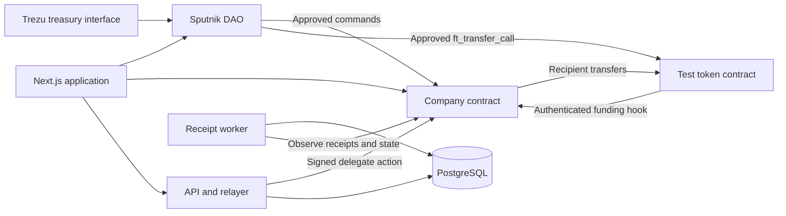

# CapTable: technical implementation plan

Status: MVP implemented and deployed to testnet; see the [README](README.md) for evidence and the [release audit](docs/RELEASE_STATUS.md) for gates. This is the original plan, prepared 25 October 2026, and is kept as written apart from this note.

**Deviations in the build:**
- **Storage:** SQLite on a single persistent host instead of PostgreSQL, because the demo has one worker.
- **Contract layout:** one `contracts/company/src/lib.rs` file instead of separate `auth`/`ledger`/`grants`/`distributions`/`events`/`types` modules.
- **Packages:** domain and NEAR helpers live in `apps/web/lib` instead of `packages/`, and the worker runs as `apps/web/scripts/reconcile-worker.mjs`.
- **Integrations:** Trezu is not integrated; funding uses direct Sputnik proposals (the planned fallback). History covers app-submitted transactions only (the disclosed fallback in §6).
- **Deployment key:** the testnet deployment key is kept rather than removed (§10); see the release audit.

The workstreams assume three contributors: a contracts engineer (C), a frontend engineer (F), and a full-stack/integration engineer (I). They describe human/team ownership, not agents already assigned. With one developer, keep the same dependency order and extend the schedule rather than promise the full scope in two weeks.

The deliverable is a testnet application demonstrating company setup, governed issuance, contributor vesting, sponsored claims, and a reconciled distribution. Ownership units are internal application records, not transferable NEP-141 tokens or legal shares. One standard NEP-141 test token is used only for payments.

## 1. Decisions that keep the implementation small

| Decision | MVP choice |
| --- | --- |
| Company deployment | One company contract instance; no factory |
| Ownership | One class, integer units, no transfers or burns |
| Governance | Existing Sputnik DAO, fixed two-of-three board policy |
| Treasury | DAO holds operating funds; company contract escrows approved distributions |
| Settlement | One explicitly allowlisted test token; fixed NEAR recipient accounts |
| Grants | Monthly vesting with a 12-month cliff and 48-month duration |
| Issuance | Recipient claims vested units; no cron-based automatic vesting transactions |
| Snapshots | Contract computes a complete immutable schedule for at most 20 holders |
| Execution | One recipient per payment transaction initially; no unbounded batch |
| Onboarding | Wallet first; one NEP-366 sponsored grant-claim flow |
| Privacy | Fictional public holdings; names and contact details private |
| Upgrades | No upgrade method in final demo build; fresh deployment for changes |

Sputnik authorizes actions. Trezu is a compatible treasury interface, not a second source of ownership or settlement truth. Do not assume its bulk-payment UI supplies an embeddable API. Verify deployed contract versions, testnet support, proposal shapes, and permissions in the first two days.

**Payment architecture choice:** the DAO approves the entitlement schedule and then transfers its exact budget into the company contract. The company contract pays those entitlements. This temporary escrow is necessary for the chosen on-chain duplicate-payment protection. Trezu can support treasury review and funding where compatible; direct Sputnik calls are the testnet fallback. Do not describe recipient payments as executed by Trezu when they originate from the company escrow.

## 2. Architecture and repository layout



Recommended stack: Rust with near-sdk for contracts, Next.js/TypeScript for the app and API, PostgreSQL for private metadata and projections, and a small TypeScript worker for receipt observation and execution jobs. Use the currently supported NEAR wallet/signing library verified in the day-one spike. Pin all dependency versions and the Sputnik deployment commit/code hash after that spike; do not track moving latest versions during the build.

```text
contracts/company/src/
  lib.rs                 # initialization and public interface
  auth.rs                # DAO, operator and recipient checks
  ledger.rs              # holdings and supply accounting
  grants.rs              # schedules, cancellation and claims
  distributions.rs       # snapshots, funding and payments
  events.rs              # versioned NEP-297 events
  types.rs               # persisted types and JSON views
contracts/company/tests/ # unit and sandbox integration tests
contracts/test-token/    # standard test-token fixture, not custom token economics
apps/web/                # screens and server routes
apps/worker/             # receipts, projections, queued payment submissions
packages/domain/         # BigInt display math, schedule builder, shared schemas
packages/near/           # clients, DAO proposal builders, network configuration
db/migrations/
scripts/                 # sandbox setup, testnet deployment, seed and demo reset
docs/                    # interface, decisions, runbook and deployment manifest
```

The backend is not an owner of holdings and cannot approve issuance. Its execution account can only invoke already-authorized payment attempts. The relayer key pays fees; it never substitutes for the user's signature.

## 3. Contract data model

Use checked integer arithmetic. Unit counts and token amounts are `u128`; JSON representations are decimal strings. Use a wide multiplication helper or validated bounds for products before division. Never use JavaScript Number or floating point for financial calculations. Token decimals are presentation metadata, not ownership precision.

| Record | Fields |
| --- | --- |
| `CompanyConfig` | `schema_version`, `dao_id`, `snapshot_operator_id`, `settlement_token_id`, `authorized_units`, `paused`, immutable demo limits |
| `LedgerTotals` | `issued_total`, `pool_available`, `grant_reserved`, `ledger_revision` |
| `Holding` | `account_id`, `issued_units`; indexed for bounded enumeration |
| `Grant` | `grant_id`, `recipient_id`, `original_units`, `entitlement_cap`, `issued_units`, `schedule_id`, `cancelled_at`, `created_revision`, `action_id` |
| `VestingSchedule` | 49 UTC timestamp boundaries: start plus months 1–48; cliff boundary index 12; convention/version |
| `Distribution` | `distribution_id`, `snapshot_revision`, `snapshot_timestamp`, `snapshot_block_height`, `token_id`, `budget`, `schedule_hash`, `expires_at`, `status`, funding and payment totals |
| `Entitlement` | `distribution_id`, `recipient_id`, `snapshot_units`, `amount`, `payment_status`, `attempt_id` |
| `ProcessedAction` | `action_id`, canonical argument hash, result identifier |

A NEAR account is the stakeholder identity for the MVP. Wallet replacement, account merging, and alternate payment addresses are deferred. One grant can increase an existing holder's balance without creating duplicate holders.

Use distinct storage prefixes for each collection. Bound holders to 20, grants to 100, distributions to 20, and privileged actions to a documented demo limit. Measure storage requirements at those limits. New-object limits must not prevent callbacks from completing existing payments. Preallocate entitlement attempt/status fields and reserve callback gas and storage headroom.

### Ownership invariants

```text
issued_total = sum(holding.issued_units)
grant_reserved = sum(grant.entitlement_cap - grant.issued_units)
fully_diluted_total = issued_total + pool_available + grant_reserved
unallocated = authorized_units - fully_diluted_total
0 <= fully_diluted_total <= authorized_units
```

Founder issuance consumes unallocated capacity. Increasing the contributor pool also consumes unallocated capacity. Creating a grant moves units from `pool_available` to `grant_reserved`. Claiming moves units from `grant_reserved` to issued holdings. Cancelling unvested units moves those units back to `pool_available`.

An active grant's `entitlement_cap` initially equals `original_units`. On cancellation, it becomes the vested amount at the cancellation transaction's block timestamp. Already vested but unissued units remain claimable. Preserve `original_units` so cancellation does not accidentally recalculate vesting against a smaller original award.

### Vesting rules

The shared schedule builder generates UTC calendar-month anniversaries anchored to the original start date, clamping the day to each month's last day. Each boundary is derived from the original start, avoiding month-to-month drift. Board approval binds the exact boundary array. The contract validates length, strict ordering, and the fixed cliff index; these explicit approved timestamps are authoritative.

```text
m = count of completed month boundaries, capped at 48
scheduled_vested = 0 if m < 12, otherwise floor(original_units * m / 48)
vested = min(scheduled_vested, entitlement_cap)
claimable = vested - issued_units
```

At month 48, the entire original award vests, subject to cancellation cap. Use contract time, never a browser-supplied current timestamp. Historical start dates are allowed for clearly labeled demo fixtures.

## 4. Public methods and permissions

All privileged checks use the immediate caller (`predecessor_account_id`), not the original transaction signer. A caller claiming to be a DAO in a JSON argument is insufficient.

| Method | Caller | Contract behavior |
| --- | --- | --- |
| `new(config)` | Deployment bootstrap, once | Initialize fixed accounts and zero ledger |
| `issue_founder_units(action_id, expected_revision, recipient, units)` | DAO | Issue against free capacity; reject stale revision |
| `increase_pool(action_id, expected_revision, units)` | DAO | Reserve unallocated capacity |
| `create_grant(action_id, expected_revision, recipient, units, boundaries)` | DAO | Reserve grant capacity and persist approved schedule |
| `cancel_unvested(action_id, grant_id)` | DAO | Freeze entitlement at current vested amount; release remainder |
| `claim_vested(grant_id)` | Grant recipient | Issue claimable units to caller only; no redirect argument |
| `prepare_distribution(expected_revision, budget, expires_at)` | Fixed snapshot operator | Compute current eligible holdings, payouts, and immutable hash |
| `approve_distribution(action_id, distribution_id, schedule_hash)` | DAO | Approve that exact unexpired schedule |
| `cancel_unfunded_distribution(action_id, distribution_id)` | DAO | Close a schedule only before funding |
| `ft_on_transfer(sender_id, amount, msg)` | Allowlisted token contract | Accept exact budget from DAO for one approved distribution |
| `pay_recipient(distribution_id, recipient_id)` | Any caller, when unpaused | Submit a fixed payment if fully funded and eligible |
| `on_payment_result(distribution_id, recipient_id, attempt_id)` | Private callback | Settle only the matching in-flight attempt |
| `set_paused(action_id, paused)` | DAO | Pause new business actions; never block settlement callbacks |

Pausing blocks new claims, snapshots, approvals, funding acceptance, and payment attempts. Callbacks, read methods, and DAO unpause remain available. Unaccepted funding returns as unused tokens through the FT resolver.

The snapshot operator can prepare bounded schedules but cannot change holdings, approve them, fund them, or select arbitrary beneficiaries. Keep this role fixed for the demo rather than implementing a second role-management system.

Privileged methods use `action_id` to prevent proposal replay: identical repeats return the original result without changing state; an existing ID with different arguments is rejected. Do not accept a supplied proposal ID as proof of approval. Store a verified proposal-to-action mapping off-chain for navigation.

Read API: `get_company`, `get_totals`, `list_holdings`, `get_holding`, `list_grants`, `get_grant`, `get_vesting_status`, `list_distributions`, `get_distribution`, `list_entitlements`, and `get_processed_action`. All lists are bounded and paginated.

## 5. Governance and payment flow

### Governed issuance

1. UI reads the ledger revision and builds exact method arguments.
2. UI displays the expected ownership effect and submits a Sputnik function-call proposal.
3. Board members approve using their own accounts.
4. Sputnik calls the company contract; the company checks DAO caller and revision.
5. UI observes the company method's execution result, not just the proposal vote count.
6. If another mutation made the revision stale, build a new proposal from current state; do not silently modify an approved payload.

Freeze the exact deployed Sputnik version and validate proposal bond, gas, deposit, and execution behavior in a sandbox. Source: [Sputnik DAO contract](https://github.com/near-daos/sputnik-dao-contract).

### Snapshot and rounding

Only issued holdings at preparation participate. Unissued grants, pool capacity, and simulated financing are excluded. The contract derives the recipient list; it never trusts a backend-provided cap table.

Calculate `floor(budget * holder_units / issued_total)` for each holder. Allocate leftover smallest-token units by descending fractional remainder, breaking ties by account ID. The resulting entitlement amounts sum exactly to the budget. Zero-value entitlements are recorded as non-payable and need no transfer.

Hash a canonical Borsh-encoded structure including network/domain tag, company contract ID, schema version, distribution ID, token, budget, snapshot revision/time/height, sorted entitlement rows, and expiry. Exclude mutable execution statuses. UI verifies the same hash before proposing approval.

Approval is of a historical snapshot; later claims or issuance must not invalidate or alter it. Expiry limits approval and initial funding, not completion of an already funded distribution.

### Funding

Use two explicit governance proposals in the MVP:

1. Approve the company distribution and its hash.
2. After approval is confirmed, call the token's `ft_transfer_call` from the DAO to fund that distribution.

This adds a second approval cycle but avoids pretending a cross-contract approval/funding workflow is atomic. A guided UI links both proposals. Single-approval orchestration is deferred.

`ft_on_transfer` verifies the token predecessor, `sender_id == dao_id`, approved status, distribution ID/hash in `msg`, expiry, and the exact expected amount. Accept once and return zero unused tokens. Wrong amounts, duplicate funding, expired schedules, or unsupported senders/tokens return all tokens unused without crediting a distribution. Plain `ft_transfer` deposits never count as authorized funding.

Register the company, DAO, and recipients with the token using its storage-management methods before the demo; the company/operator funds those deposits. Keep native NEAR for storage, execution, and the attached deposit required by token transfers. Source: [NEAR FT receiver security](https://docs.near.org/smart-contracts/security/cross-contract-calls/ft-transfer-call).

### Payment state machine

```text
Ready -> InFlight(attempt N) -> Paid
                           -> Failed -> InFlight(attempt N+1)
```

Before creating an FT transfer promise, increment the attempt ID and mark the entitlement in-flight. The token receiver and amount are always loaded from the frozen entitlement. Send via `ft_transfer`, not a recipient-controlled transfer hook. The private callback records success or confirmed failure for that attempt. Paid and in-flight entitlements cannot be submitted again.

Track conservation in token base units:

```text
funded_total = paid_total + in_flight_total + available_escrow
```

Moving to in-flight reserves funds. A confirmed failure releases the reservation; success moves it to paid. Keep funds segregated by distribution even though the token contract exposes one aggregate company balance.

Start with one recipient per call and a serial execution worker. The UI may request all unpaid recipients, but the worker breaks that request into bounded calls. Callbacks are private, small, and allocation-bounded. Reserve gas based on sandbox measurements with margin.

If the token transfer succeeds but its callback fails, the on-chain record remains in-flight. The worker marks its observation `NeedsReview`, surfaces the receipt evidence, and blocks retry. **No timeout-based reset and no backend instruction that marks it failed.** Automatic recovery from a missing callback is outside the MVP; leave funds/entitlements locked pending a separately designed recovery mechanism. Ordinary confirmed payment failure and retry are mandatory and demonstrated.

This limitation follows from NEAR's independent cross-contract receipts and callback failure behavior. Sources: [cross-contract calls](https://docs.near.org/smart-contracts/anatomy/crosscontract), [callback failures](https://docs.near.org/smart-contracts/security/cross-contract-calls/callback-failures).

## 6. Backend, events, and sponsored transactions

### Database model

| Table | Main fields and constraints |
| --- | --- |
| `companies` | UUID, network, contract ID (unique per network), DAO ID, private display name |
| `stakeholders` | company ID, account ID (unique together), private display name/email |
| `sessions` | account ID, challenge nonce hash, expiry, verified signature context |
| `proposals` | network, DAO ID, proposal ID (unique together), action ID, payload hash, observed status |
| `operations` | company ID, operation ID, originating transaction hash, signer, lifecycle status |
| `receipt_observations` | network, receipt ID, final block hash, execution result, related operation |
| `chain_events` | network, receipt ID, log index (unique together), contract ID, event version, payload |
| `payment_jobs` | distribution ID, recipient, attempt ID, submission state, transaction hash; unique attempt |
| `sponsor_requests` | delegate-action digest (unique), account, method, grant, gas/deposit budget, outcome |

Contract balances and entitlements are authoritative. Database payment states are observations and job state, never a replacement for contract authorization. On reconnect or recovery, query on-chain state before submitting another action.

Authenticate private API access with an expiring, domain-bound wallet-signed challenge and a server session. A wallet address supplied in a request is not authentication. Resolve board access from the configured DAO; contributors see only their private profile data. Public holdings remain public regardless of UI access controls.

### Events and reconciliation

Emit versioned `captable` NEP-297 events for founder issuance, pool changes, grant creation/cancellation/claim, snapshot preparation, distribution approval/funding, payment initiation/result, and pause changes. Events carry identifiers, units, and revisions, never emails or document contents. Source: [NEAR structured events](https://docs.near.org/smart-contracts/anatomy/events).

Persist transaction hashes immediately for app/worker submissions. Observe the complete receipt chain, including DAO-created receipts, at finality. Retry read failures with backoff. Deduplicate by receipt ID and log index. Periodically compare projected totals and payment statuses with enumerable contract views.

Day two must select a network-compatible event/indexer provider capable of backfilling this contract's finalized logs, or restrict the demo to tracked application submissions and disclose that external activity history is incomplete. Standard account RPC reads are not an assumed historical event subscription. Current holdings/grants/distributions remain reconstructible from contract views even if the history index is unavailable.

### Minimal endpoints

```text
POST /api/auth/challenge             -> expiring wallet challenge
POST /api/auth/verify                -> verified session
GET  /api/companies/:id              -> configuration and projection freshness
POST /api/companies/:id/proposals    -> validate/build proposal, user signs submission
POST /api/transactions/observe       -> register hash; server verifies actual transaction
POST /api/sponsor                   -> validate and relay signed delegate action
POST /api/distributions/:id/execute -> enqueue fixed existing entitlements
GET  /api/operations/:id             -> receipt-aware progress
```

### Sponsored claim

Scope sponsorship to `claim_vested(grant_id)` only. The user signs an NEP-366 delegate action with a compatible wallet/signing adapter; the server validates it and pays the outer transaction fee. The inner receiver must be the configured company, with one allowed method, exact schema, zero attached deposit, bounded gas, valid expiry, and the user's own eligible grant. Enforce per-account and global spend/rate limits, and deduplicate delegate digests. Never accept arbitrary serialized transactions for sponsorship.

The claim has no recipient argument and can only increase the caller's own holdings. Test that the recipient is correctly recognized as the predecessor through the delegate path. Account creation and storage funding are separate setup costs. Use a demo account with no spendable gas to prove sponsorship, rather than claiming a pre-funded wallet demonstrates it.

NEP-366 requires a user signature and an initialized account; relaying does not create either automatically. Wallet support is a day-two gate. If the first wallet cannot sign delegate actions, choose a supported adapter early; do not replace the user signature with a server-held user key. Source: [NEAR meta-transactions](https://docs.near.org/protocol/transactions/meta-tx).

## 7. Frontend screens

Every screen displays the network and company. Transaction components distinguish awaiting signature, submitted, executing, confirmed, failed, and outcome unknown. Avoid optimistic updates to authoritative holdings or payment success.

| Route | Screen and actions | Required states |
| --- | --- | --- |
| `/setup` | Configure company; connect verified DAO; propose founder issuance and pool; attach/deploy through setup flow | Deployment pending, invalid DAO, proposal awaiting votes, execution failed |
| `/company/:id` | Overview: issued/fully diluted totals, pool, pending approvals, funded distributions | Empty company, stale projection, paused |
| `/company/:id/ownership` | Holdings table; denominator toggle; supply reconciliation; founder issuance proposal | Unallocated capacity, insufficient capacity, stale revision |
| `/company/:id/grants` | Grant list and creation drawer; units, recipient, UTC boundaries, cliff preview | Pool shortage, invalid dates, proposal pending |
| `/company/:id/grants/:grantId` | Granted/vested/issued/unvested values, timeline, claim, cancellation proposal | Before cliff, eligible, fully claimed, cancelled with vested remainder |
| `/company/:id/approvals` | Typed proposal review, expected effects, raw target/method/args, board votes | Proposed, rejected, expired, approved but execution failed, completed |
| `/company/:id/distributions` | Budget entry; contract-generated snapshot preview; approve and fund steps | No issued units, expired snapshot, unfunded, ready |
| `/company/:id/distributions/:distributionId` | Frozen recipients, hash, funding proposal, execute, individual retries and receipts | Partial failure, in-flight, needs review, complete |
| `/me` | Personal holdings, grants, sponsored claim, distribution history | Wallet disconnected, unsupported signer, no grants, sponsor unavailable |
| `/company/:id/activity` | Event timeline and transaction/receipt links | Indexer lag, history gap, chain confirmed |

Company setup is sequential orchestration, not atomic deployment. For the final demo, use a pinned Sputnik deployment procedure with three pre-created member accounts. The UI may attach that DAO and initialize a company instance; automated DAO factory creation is not required. If deployment occurs through a setup script rather than the UI, show the pre-created company honestly and keep founder issuance live.

Do not build a separate full treasury dashboard. Show the relevant treasury balance, funding proposal, and a Trezu link only when the selected network/account is supported.

## 8. Prioritized two-week backlog

P0 means required for the end-to-end demonstration. P1 means required for the MVP release once the core path works. P2 is optional stretch and cannot displace a failed P0/P1 gate. Tests for an item ship with it; days 11–12 exercise integrated and adversarial cases rather than postponing all testing.

| Day | Priority / owner | Concrete work | Exit condition |
| --- | --- | --- | --- |
| 1 | P0 C + I; F foundation | Scaffold workspace/CI; pin SDK and Sputnik build; deploy stub company and test token; wallet connection and network guard | A wallet calls the stub; sandbox/testnet configs are reproducible |
| 2 | P0 C + I; F proposal UI | Execute a two-of-three DAO function call; DAO FT funding and recipient payment spike; sign/relay a delegate claim stub; verify Trezu and history-provider compatibility | Actual receipts prove all critical integrations; fallback choices recorded |
| 3 | P0 C; F ownership; I setup | Implement ledger, capacity accounting, command idempotency, paginated views; setup and seeding scripts | Governed founder issuance/pool updates reflected correctly in UI |
| 4 | P0 C + F | Implement approved schedules, grant reservation, vesting math, and claim; recipient portal | Cliff and full-term cases pass; claim updates holdings without double counting |
| 5 | P0 C; P1 F + I | Add cancellation preserving vested rights; sponsored claim endpoint and UI; grant/approval receipt mapping | User with no spendable gas claims eligible units; cancel/reclaim cases pass |
| 6 | P0 C + F | Implement snapshots, exact rounding, canonical hash, expiry, approval review | Later issuance cannot change schedule; tampered hash cannot be approved |
| 7 | P0 C + I; F funding flow | Implement FT funding validation and two-proposal approval/funding workflow; storage registrations | Exact authorized funding accepted once; wrong/duplicate funding never credits |
| 8 | P0 C + I + F | Implement payment attempt locking, callbacks, execution queue, individual retry UI | Multi-recipient payment completes; failed recipient retries without duplicate payouts |
| 9 | P1 I + F; C hardening | Reconciliation worker, finality-aware receipt UI, event persistence, private profile auth | Refresh/restart preserves progress; known callbacks and pending states match contract |
| 10 | P0/P1 all | Run complete seeded lifecycle; pause rules, amount limits, callback gas/storage checks | Feature-complete MVP with three demo flows; otherwise no stretch work |
| 11 | P0 C + I; P1 F | Adversarial integration tests, sponsor abuse limits, concurrency and replay, partial failure cases | No unauthorized issuance, cross-distribution spending, or duplicate settlement |
| 12 | P1 all | Browser E2E, cold rebuild/redeploy, history-gap and callback-unknown runbook, mobile/readability fixes | Another team member can reproduce the demo from instructions |
| 13 | P1 all | Freeze contract build; verify deployment hashes/keys; prepare docs, screenshots, and script | Release candidate and recorded fallback demo available |
| 14 | P1 all | Final rehearsal from clean state, video, submission, issue list | Deliverable includes live app, source, contracts, receipts, and explicit limitations |

### Dependency gates and cut order

- **Day 2:** No new modules until DAO execution, FT transfer, and sponsored signing are demonstrated. If Trezu is unavailable on testnet, switch to direct Sputnik integration. If the event provider is unavailable, keep tracked-receipt history plus authoritative state reads and disclose coverage.
- **Day 5:** Governed issuance, grant accounting, and recipient claim must work together.
- **Day 8:** Approved schedule to confirmed recipient payment and ordinary failure retry must work.
- **Day 10:** All MVP functionality is integrated. Remaining days protect reliability and presentation.
- Cut decorative certificates, extensive dashboard charts, additional wallets, embedded Trezu navigation, and batch optimization first. Cut all stretch work before removing authorization, payment locks, receipt verification, or core accounting tests.

## 9. Verification and deterministic demo

Use Rust unit tests for math/invariants, NEAR Sandbox for actual cross-contract and governance behavior, and browser E2E for the three journeys. Sandbox supports controlled time and callback failure scenarios; a frontend mock alone cannot verify the payment model. Source: [NEAR integration testing](https://docs.near.org/smart-contracts/testing/integration-test).

Required cases:

1. Non-DAO caller and spoofed signer cannot invoke governed mutations; initialization cannot repeat.
2. Duplicate action IDs do not mutate twice; mismatched payload reuse fails; stale revisions fail.
3. Random sequences of grants, claims, and cancellations preserve supply invariants.
4. Before cliff, exact cliff, monthly boundaries, end date, non-divisible grants, and cancellation around boundaries.
5. Snapshots reject zero issued supply; deterministic rounding totals exactly equal budget.
6. Post-snapshot issuance does not affect entitlements; hash tampering and expiry fail.
7. Wrong token, wrong sender, duplicate, under/over, and malformed funding do not create credit.
8. Concurrent payment attempts result in one transfer; stale/private callback spoofing cannot settle an attempt.
9. Unregistered FT recipient fails; after registration, retry pays once. Successful recipients are untouched.
10. Successful transfer with failed callback remains blocked for review; timeout never enables a second payment.
11. Sponsor rejects wrong receiver/method/deposit/account, replay, expired action, and over-budget request.
12. Worker restart, duplicate events, RPC failure, and browser reload do not change authoritative results.

Demo fixture:

- Authorized: 10,000,000 units.
- Founder A: 3,600,000 issued; Founder B: 2,400,000 issued.
- Contributor pool: 2,000,000; unallocated capacity: 2,000,000.
- Contributor grant: 100,000 units; at the one-year cliff, 25,000 become claimable.
- After claim: issued = 6,025,000; pool available = 1,900,000; grant reserved = 75,000; fully diluted = 8,000,000.
- Distribution: 10,000 TESTUSD, six decimals, equal rights per issued unit.
- Using the specified largest-remainder rule: Founder A receives 5,975.103734 TESTUSD, Founder B receives 3,983.402490, contributor receives 41.493776; total = 10,000.000000.
- Leave the contributor unregistered with the test token for the failure-retry demonstration, then register and retry. This is a deliberately staged failure, not the normal onboarding flow.

## 10. Release and longer-term boundaries

Deployment manifest records network, accounts, DAO code hash/version/policy, company WASM hash, test-token identity/decimals, storage funding, and remaining access keys. Remove the company deployment full-access key only after release verification; its removal is an explicit deployment step, not something this planning document executes. With no key and no upgrade method, the demo contract is intentionally fixed. Keep DAO member keys in their wallets. Redeploy under a fresh company account for later development.

Do not add arbitrary treasury withdrawals, entitlement redirects, or manual “mark unpaid” methods to simplify a demo. Document stranded direct deposits and unresolved callback cases as limitations of the testnet prototype. Production needs designed recovery, accounting, privacy, upgrade, and legal-document relationships before handling real ownership or value.

Optional P2 work after all gates pass:

- NEAR Auth/passkey login with provider access and recovery assumptions verified.
- One off-chain SAFE simulation with no writes to the real ledger.
- One separately budgeted mainnet Intents payout route; label previews and network separation. Intents currently documents no testnet service: [FAQ](https://docs.near-intents.org/resources/faqs).
- Verification page displaying the contract revision, holdings, and receipt links.

Longer-term seams are already explicit: a factory can deploy separate company instances; shared Global Contracts can reuse code; a settlement adapter can support Intents or Chain Signatures without changing ownership accounting; additional instruments require new economic policies; confidentiality requires a different data-disclosure design. None of these extensions is implemented by the MVP plan.
