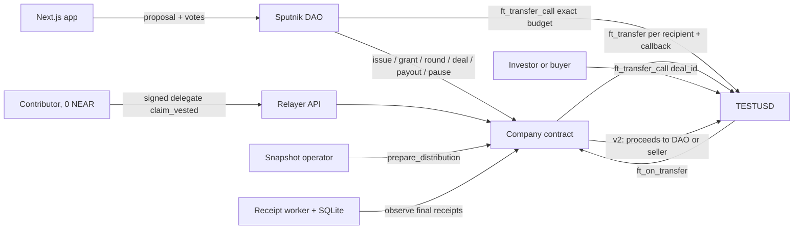

# Captab

**DAO-governed company ownership on NEAR, from day zero to exit.** A board approves every change through a Sputnik DAO. A company contract keeps the ownership ledger, vests contributor grants, sells new units to investors in the same transaction that takes their money, settles secondary sales and buybacks, and pays holders from exact, immutable payout lists, so no one is ever paid twice.

> Testnet prototype. Ownership units are on-chain ledger records, not share tokens or legal equity. TESTUSD is a demo NEP-141 token. All holders are fictional.

## From day zero to exit

| Stage | What the company needs | How Captab does it | Status |
| --- | --- | --- | --- |
| **1. Found** | Authorized units, a founder split, a board, founder vesting | The DAO council is the board (2 of 3 on testnet). `issue_founder_units` records the split with the SHA-256 of the founders' agreement; `create_grant` with `source: Unallocated` vests founders' units; `increase_authorized` amends the charter | Live on testnet |
| **2. Hire** | An equity pool, grants with a cliff and monthly vesting, signed terms | `increase_pool` / `decrease_pool`; `create_grant` with 1–120 monthly steps and any cliff; the recipient signs the grant document's hash with `accept_grant`; `claim_vested` works with **zero NEAR** through a sponsored relayer; `cancel_unvested` keeps vested rights | Live on testnet |
| **3. Raise** | Priced rounds, a valuation trail, investors paid in and issued at once | The app's round model computes price per unit, new units, and pool top-up. The board opens a round (`create_round`) and approves an issuance deal per investor. The investor pays with `ft_transfer_call`; units are issued in the same receipt and the money goes to the DAO treasury. A wrong amount, payer, or expired deal is refunded | Live on testnet (schema v2) |
| **4. Operate** | Board approvals, corrections, lost wallets, audit-ready records | Every change is a DAO proposal with a replay-safe action ID and an expected ledger revision. `retire_units` corrects errors; `reassign_holding` moves a lost wallet's units and open grants. The cap table exports as CSV or JSON with its revision and SHA-256, and the app audits the ledger against on-chain totals | Live on testnet |
| **5. Liquidity** | Secondary sales for early holders, buybacks and tender offers | Secondary deal: the board approves, the seller signs to lock their units, the buyer pays, units move and the seller is paid. Buyback deal: the seller signs, the DAO pays, units are retired. Held payments can be retried by anyone | Live on testnet (schema v2) |
| **6. Pay holders** | Dividends or distributions that sum exactly | Pro-rata snapshot with largest-remainder rounding and a schedule hash the board approves; exact-budget funding from the DAO; one payment per holder, retry-safe | Live on testnet |
| **7. Exit** | Acquisition proceeds split by preference, accelerated vesting, a final record | The app's exit waterfall applies liquidation preferences; the board pays its rows as an explicit payout list (`prepare_explicit_distribution`). `accelerate_grant` handles acceleration. `close_company` makes the ledger final once every payout and deal is settled | Live on testnet; close proven in NEAR Sandbox |

**What Captab does not do.** Units are not legal shares, so an IPO itself happens off-chain: Captab hands the transfer agent or acquirer a verifiable export, pays the proceeds, and closes the ledger. SAFEs and convertible notes, stock options with an exercise price, and investor KYC are not modeled; a converted SAFE can be issued as an issuance deal at its conversion price. Wallet-visible share tokens are a [later stage](docs/TOKENIZATION_PLAN.md).

## Why NEAR

| NEAR primitive | How Captab uses it |
| --- | --- |
| [Sputnik DAO](https://github.com/near-daos/sputnik-dao-contract) (pinned commit `5434a59`, WASM hash verified) | A board approves every issuance, grant, round, deal, buyback payment, payout, and pause. The company contract trusts only the DAO as the immediate caller. |
| [NEP-366 meta-transactions](https://github.com/near/NEPs/blob/master/neps/nep-0366.md) | A contributor with **zero NEAR** signs a `claim_vested` delegate action, and a scoped relayer pays the gas. |
| [NEP-141](https://github.com/near/NEPs/blob/master/neps/nep-0141.md) `ft_transfer_call` | The DAO funds a distribution in a single transfer; the contract accepts only the exact approved budget, from the DAO, once. An investor or buyer pays for a deal the same way, and the units move in the same receipt or the payment is refunded. |
| Promises and callbacks | Each payout is a separate `ft_transfer` with a private callback. A failed transfer can be retried; a lost callback stays locked rather than risking a double payment. |
| [NEP-413](https://github.com/near/NEPs/blob/master/neps/nep-0413.md) signed messages | Wallet-signed sign-in gives private (off-chain) access to names and emails. |
| NEP-297 events | Every ledger change emits a versioned `captable` event. |

## Live on testnet

Two deployments run side by side. Schema v2 covers the whole lifecycle; schema v1 is the original MVP.

| Role | Schema v2 (full lifecycle, code on `main`) | Schema v1 (MVP, tag `v1-testnet`) |
| --- | --- | --- |
| Company contract | [`captab-company-0d07df99e1bb0e44.testnet`](https://testnet.nearblocks.io/address/captab-company-0d07df99e1bb0e44.testnet) | [`captab-company-101e85b169dd3522.testnet`](https://testnet.nearblocks.io/address/captab-company-101e85b169dd3522.testnet) |
| Sputnik DAO (2 of 3 council) | [`captab-dao-0d07df99e1bb0e44.testnet`](https://testnet.nearblocks.io/address/captab-dao-0d07df99e1bb0e44.testnet) | [`captab-dao-101e85b169dd3522.testnet`](https://testnet.nearblocks.io/address/captab-dao-101e85b169dd3522.testnet) |
| TESTUSD (6 decimals) | [`captab-token-0d07df99e1bb0e44.testnet`](https://testnet.nearblocks.io/address/captab-token-0d07df99e1bb0e44.testnet) | [`captab-token-101e85b169dd3522.testnet`](https://testnet.nearblocks.io/address/captab-token-101e85b169dd3522.testnet) |
| Manifest | [v2 manifest](docs/deployment-manifest.v2.testnet.json) | [v1 manifest](docs/deployment-manifest.testnet.json) |
| Live rehearsal | [v2: round, secondary, buyback, payout list](docs/testnet-v2-rehearsal.json) | [v1: payout and retry](docs/testnet-rehearsal.json), [browser governance](docs/testnet-browser-rehearsal.json) |

Each manifest records code hashes, the full DAO policy, token supply, and storage funding. `CAPTAB_DEPLOYMENT=v2 pnpm verify:testnet` (from `main`) and `pnpm verify:testnet` (from tag `v1-testnet`, which rebuilds the v1 WASM byte for byte) re-check them against live chain state and exit nonzero on any drift.

Demo: [motion overview](docs/demo/captab-motion-30s.mp4) (30 s) · [live read-only walkthrough](docs/demo/live-testnet.webm) (31 s, v1) · [fixture walkthrough and screenshots](docs/demo/README.md)

## How it works



1. **Issue.** The board votes; the DAO calls `issue_founder_units` or `increase_pool`. Each call carries an `action_id` (replay-safe) and an `expected_revision` (rejected if stale).
2. **Grant and vest.** `create_grant` reserves pool units against approved UTC month boundaries; the app's default is a 12-month cliff, then monthly vesting to 48 months (v2 accepts 1 to 120 months and any cliff, and the recipient can sign the grant terms). The recipient calls `claim_vested` directly or through the sponsored relayer. Cancellation releases only unvested units.
3. **Distribute.** The operator prepares a snapshot. The contract derives every holder's payout with largest-remainder rounding, so payouts sum exactly to the budget, and hashes the schedule. The DAO approves that hash, then funds it. Payments run one recipient at a time; a failed one can be retried. In v2 the board can instead set an explicit payout list (for example an exit waterfall), funded and paid by the same machinery.
4. **Raise and trade (v2).** The board approves a deal. For new units, the investor pays with `ft_transfer_call` and the units are issued in the same receipt; for a secondary sale or buyback, the seller first signs to lock their units. Proceeds go to the DAO (issuance) or the seller, and a held payment can be retried by anyone.

### Planning tools (app only)

These help a company plan its next steps. They compute in the browser; acting on a result is a separate DAO proposal.

- **Cap table export.** `GET /api/companies/<id>/export?format=csv|json` returns holdings, grants, pool, and totals at one ledger revision. The response headers give the revision and the SHA-256 of the file, so a lawyer or auditor can check they received the same file. It rejects a read during which the ledger changed. Spreadsheet formula characters are neutralized. Download links are on the ownership pages.
- **Priced-round model** (`/company/<id>/ownership`). Enter a pre-money valuation, an investment, and a pool target to see the price per unit, the new investor units, any pre-money pool top-up, and the before and after table. It warns when the round would need more units than are unallocated. On a schema v2 company the board executes the round with `create_round` and an issuance deal per investor (see the Deals page).
- **Exit waterfall preview** (`/company/<id>/distributions`). Splits sale proceeds across issued units and grants (accelerated or cancelled unvested units), after optional liquidation preferences (multiple, participating or not). Non-participating holders convert to common when that pays more. Integer math with largest-remainder rounding, the same rule the contract uses for payouts, so the rows sum to the proceeds exactly. On a schema v2 company the preview's payout lines go straight into an explicit payout list proposal.
- **Any majority council.** Governance works with any council size on the pinned Sputnik build, as long as only the council can vote and approval needs a majority. The app shows the rule (for example "2 of 3"). Code: [`dao-policy.ts`](apps/web/lib/dao-policy.ts), [`cap-table-export.ts`](apps/web/lib/cap-table-export.ts), [`round-model.ts`](apps/web/lib/round-model.ts), [`waterfall.ts`](apps/web/lib/waterfall.ts). Tests: `pnpm test:dao`, `pnpm test:planning`, and three browser tests.

## Claims and evidence

Every claim below is backed by a test you can run or a transaction you can open.

| Claim | Code | Local proof | Testnet proof |
| --- | --- | --- | --- |
| Only the DAO can change ownership | [`assert_dao`](contracts/company/src/lib.rs#L267) | `non_dao_cannot_issue` | Proposals [6](https://testnet.nearblocks.io/txns/6ekVUH6L7vbsWH4aeSjdG99RCbgKjB8W3hbPLQfdCU7v) and [7](https://testnet.nearblocks.io/txns/CpkKMtFCpVVYGrHAnc1bbApbrPJdUYvQnKtJw1SaMYJU) (pause/resume), each executed after [two](https://testnet.nearblocks.io/txns/9F1KBfKMoMLu7uj86uyG4T7ZD98fcPVbrdHsuQ3GBXJV) [votes](https://testnet.nearblocks.io/txns/GL8m4DFKDoFvBMqVyNUVXkbJXsquUMUSWq5FLCa4giXK) |
| A council majority is required (2 of 3 on testnet) | [`assessDaoPolicy`](apps/web/lib/dao-policy.ts) | Sandbox `real_sputnik_requires_two_votes_and_funds_company`; `pnpm test:dao` | Same as above |
| Replayed or repurposed actions cannot double-issue | [`was_processed`](contracts/company/src/lib.rs#L313) | `identical_replay_is_idempotent_even_after_revision_changes`, `action_id_cannot_be_repurposed`, `stale_revision_rejected` | — |
| Supply invariants hold across every operation | [`unallocated`](contracts/company/src/lib.rs#L292) | `mixed_ledger_operations_preserve_accounting_after_every_step`, `cannot_exceed_authorized_supply` | `pnpm verify:testnet` audits the live ledger |
| Vesting: cliff, monthly steps, cancellation | [`vested_at`](contracts/company/src/grants.rs#L232) | `grant_reservation_cliff_claim_and_full_vesting`, `cancellation_releases_only_unvested_units`, `another_account_cannot_claim` | — |
| Contributor with zero NEAR claims via sponsored relay | [`claim_vested`](contracts/company/src/grants.rs#L194), [`apps/web/lib/sponsor-policy.ts`](apps/web/lib/sponsor-policy.ts) | Sandbox `zero_balance_contributor_claims_through_signed_delegate`; `pnpm test:sponsor` | Grant [proposal 8](https://testnet.nearblocks.io/txns/AHUbthZ5ZtauqMet2GTaQynoYp6xJUwdi2t712ub8GCZ) → [sponsored claim](https://testnet.nearblocks.io/txns/AAeXAhfrj6k76LiCSMDSwCA8f2kpMzAoRhqAZYiKz7Hh) |
| Payouts sum exactly to the budget, and later issuance cannot change them | [`prepare_distribution`](contracts/company/src/distributions.rs#L116) | `snapshot_rounds_exactly_and_survives_later_issuance`, `distribution_hash_matches_typescript_vector` | 10,000.000000 TESTUSD paid as 5,975.103734 + 3,983.402490 + 41.493776 ([evidence](docs/testnet-rehearsal.json)) |
| Funding is accepted only for the exact approved budget, from the DAO, once | [`ft_on_transfer`](contracts/company/src/lib.rs#L240), [`fund_distribution`](contracts/company/src/distributions.rs) | `only_exact_dao_token_funding_is_accepted_once`, `approval_rejects_modified_hash` | Distribution 0 funded, zero escrow left |
| A failed payment can be retried and never pays twice | [`pay_recipient`](contracts/company/src/distributions.rs#L237), [`on_payment_result`](contracts/company/src/distributions.rs#L265) | `failed_payment_releases_reservation_and_retry_pays_once`, `in_flight_attempt_blocks_duplicate_transfer`, `stale_payment_callback_cannot_settle_current_attempt`; Sandbox `seeded_demo_lifecycle_settles_exact_amounts_after_retry` | Contributor [attempt 1 failed](https://testnet.nearblocks.io/txns/3LaFRfpVNhoz2mMwFQ24ysNd8eeS8L7BBg7otP2s6ewf) (unregistered) → [attempt 2 paid](https://testnet.nearblocks.io/txns/59XfZEHbBXtFVNWPHQcQSFyQ7DSC4Lm4fgaJuHwPAiQy); founders [A](https://testnet.nearblocks.io/txns/DFj77QurbryvmF47k9EVAS1KWzMyi1JAQq4CH3nWsvYv), [B](https://testnet.nearblocks.io/txns/35NBSJHu9ZapVAkh3MfvEFoCR3Rn3oZzZk5X3i4Cqegj) |
| A lost callback stays locked instead of risking a double payment | [`on_payment_result`](contracts/company/src/distributions.rs#L265) | `failed_callback_after_successful_transfer_never_unlocks_payment`; Sandbox `successful_token_transfer_with_failed_callback_stays_locked` (fault-injection build) | — |
| Pause stops new actions; in-flight callbacks still settle | [`set_paused`](contracts/company/src/ledger.rs#L7) | `pause_rejects_new_funding_but_preserves_in_flight_callback_settlement`, `pause_blocks_new_payment_attempts` | Proposals 6 and 7 |
| Storage stays bounded at demo limits | [constants](contracts/company/src/lib.rs#L24) | Sandbox `bounded_storage_still_allows_payment_callback_at_demo_limits` ([measurements](docs/STORAGE_LIMITS.md)) | Storage preflight in the manifest |
| Worker crash or restart cannot cause a duplicate payout | [`apps/web/lib/payments.ts`](apps/web/lib/payments.ts) | `pnpm test:payments`, `pnpm test:worker-restart` | — |

Testnet transaction hashes come from the [payout rehearsal](docs/testnet-rehearsal.json) and the [browser rehearsal](docs/testnet-browser-rehearsal.json). Unit test names are in [`tests.rs`](contracts/company/src/tests.rs) and [`tests_v2.rs`](contracts/company/src/tests_v2.rs); Sandbox tests are in [`contracts/company/tests/sandbox.rs`](contracts/company/tests/sandbox.rs).

## Contract v2 evidence: raising, secondaries, and exit

Schema v2 extends the ledger from founding and hiring to raising money, secondary sales, buybacks, and exit. It is tested locally, on NEAR Sandbox, and live on testnet as a second deployment beside the v1 MVP ([accounts](#live-on-testnet)). The app reads both.

The live rehearsal (`pnpm rehearse:v2`, [evidence](docs/testnet-v2-rehearsal.json), [manifest](docs/deployment-manifest.v2.testnet.json)) ran every board action through two-of-three Sputnik votes:

| Step on testnet | Transactions |
| --- | --- |
| Charter amendment to 12,000,000 units with a document hash | [proposal 1](https://testnet.nearblocks.io/txns/JBCCbvP4YtmZFAmhcAxHaiPXC5Jy3W2iP9oW9pxzdVSn) |
| Contributor accepts the grant document, then claims 25,000 units at the cliff | [accept](https://testnet.nearblocks.io/txns/CE4y23r3fiRcM81FrCk9eDgpQadM6i8BWxKNHxyrMEba), [claim](https://testnet.nearblocks.io/txns/FyFBrAFfkQz1DLPTS9JQR5AsTVEf13Ecm5Q2FHZecmdf) |
| Founder vesting from unallocated capacity, accelerated 12 months, claimed; pool reduced | DAO proposals 6, 7, 8 |
| Seed round: a wrong amount and a wrong payer are refunded; the investor's exact 10,000 TESTUSD issues 1,000,000 units and reaches the DAO | [refund: amount](https://testnet.nearblocks.io/txns/38fDEUrTUDA2jeHMUvqrnv4JSqJs4XsYnwyhjFTrsYNE), [refund: payer](https://testnet.nearblocks.io/txns/GzNAauqwev72UhRjmWAyJkwvujWAB4jysaBGQudoCmQb), [payment](https://testnet.nearblocks.io/txns/DGY7VapS6G9b8XCzaT8y3LnMpXbb1mUpRUVydX184Jmd) |
| Secondary sale: seller signs, buyer pays, proceeds held for the unregistered seller, then delivered by a public retry | [accept](https://testnet.nearblocks.io/txns/FKfosRrYSo94ao94dWxDhRhaqqbtstYmH8hyu6HEEqSd), [payment](https://testnet.nearblocks.io/txns/9gBWG3pbnz2yfSNwrZ6vZDN4QnDRjdgT2sv62aFYCGE9), [retry](https://testnet.nearblocks.io/txns/EGuQtscaKtLKcaEb1qiByeQGdG7ajRxJDNcJFpmB5KY6) |
| Buyback: contributor signs, the DAO pays through a proposal, 5,000 units retired | [accept](https://testnet.nearblocks.io/txns/7JuZfuvezp9AwLAeWZMr9rf7PDRxgSDSdbDp5PfP1XTo), [DAO payment](https://testnet.nearblocks.io/txns/EtXZJ5Egqj8mZqKZb3NoWmBvrdsci6gK6sT7v6apj9oj) |
| Board-set payout list of 2,000 TESTUSD, funded exactly and paid to five holders | [funding](https://testnet.nearblocks.io/txns/HVefYMr38JD72oebKw7gCR7BFb8vaTx61ThZ8Y9GQqCf), [first payment](https://testnet.nearblocks.io/txns/9SZVkKe9RKhe8wMHF3j4v4c1djzucKBP1MREwCsg6cCb) |

Afterwards the ledger holds 7,140,000 issued units across five holders, the DAO treasury is exactly 72,940 TESTUSD, the app's audit reports **Consistent**, and `CAPTAB_DEPLOYMENT=v2 pnpm verify:testnet` passes. Closing the company is proven in Sandbox only, so the testnet company stays usable as a demo.

| Capability | Contract method | How it works |
|---|---|---|
| Document fingerprints | `doc_hash` on every board action | A SHA-256 of the governing document (charter amendment, grant agreement, purchase agreement) is part of the action's replay digest and its event |
| Charter amendment | `increase_authorized` | Raises authorized units; they can never be lowered |
| Pool management | `decrease_pool` | Returns unused pool units to unallocated capacity |
| Flexible vesting | `create_grant` with `terms` | 1 to 120 monthly boundaries, any cliff (including none), and reservation from the pool or from unallocated capacity (founder vesting) |
| Acceleration | `accelerate_grant` | The board counts extra completed months, for example on an acquisition |
| Grant acceptance | `accept_grant` | The recipient signs the grant document's hash on chain |
| Investor rounds | `create_round`, `close_round` | A round records its price per unit (the valuation trail), units issued, and amount raised |
| Investor issuance, paid atomically | `approve_deal` (`Issue`) + `ft_transfer_call` | The board reserves units for a named investor at the round price. The investor pays with the settlement token, units are issued in the same receipt, and the money is forwarded to the DAO treasury. A wrong amount, payer, or an expired deal is refunded by the token |
| Secondary sales | `approve_deal` (`Secondary`), `accept_deal` | The board approves; the seller signs to lock their units; the buyer pays; units move and the seller is paid. No unit moves without both the board and the holder |
| Buybacks and tender offers | `approve_deal` (`Buyback`) | The seller accepts, the DAO pays through a proposal, and the units are retired |
| Payout delivery | `forward_proceeds` | If a recipient is not registered with the token, the payment is held and anyone can retry; a lost callback stays locked for review |
| Explicit payout lists | `prepare_explicit_distribution` | The board sets exact amounts per stakeholder (an exit waterfall with liquidation preferences), then funds them with the existing exact-funding and per-recipient payment machinery |
| Corrections | `retire_units` | Board-approved retirement of unlocked units |
| Lost wallets | `reassign_holding` | Moves a holding and its open grants to a new account; blocked while the old account has an unpaid payout or an open deal |
| Close after exit | `close_company` | Final state once every distribution is paid or cancelled and every deal is settled or cancelled. Nothing can reopen it |
| Room to grow | limits | 100 holders, 200 grants, 50 distributions, 200 deals, 20 rounds; governance actions are no longer capped, so resume always works. Payout rows live in their own map, so a payment no longer rewrites the whole table |

The app gains a **Deals** page (rounds, deal states, seller acceptance, buyer payment, payout retry), twelve new board actions under Approvals, an "accept grant terms" button, payout lines from the exit preview for an explicit payout proposal, and v2-aware audit, export, and event parsing.

**Evidence:** 74 Rust unit tests (46 for v2, in [`tests_v2.rs`](contracts/company/src/tests_v2.rs)). Sandbox `v2_round_secondary_buyback_explicit_payout_and_close_through_real_sputnik` runs a charter amendment, a seed round with a refunded wrong payment and a paid allocation, a secondary sale whose unregistered seller is paid by a later retry, a DAO-paid buyback, an explicit exit payout, and the close, all through two-of-three Sputnik votes. The stress test fills every v2 limit: a 100-holder snapshot burns 35.8 Tgas and state grows by 1.14 MB ([measurements](docs/STORAGE_LIMITS.md)). The pro-rata schedule hash is unchanged from v1, and the explicit-list hash is checked against the TypeScript implementation. Contract code is split into [`ledger.rs`](contracts/company/src/ledger.rs), [`grants.rs`](contracts/company/src/grants.rs), [`distributions.rs`](contracts/company/src/distributions.rs), and [`deals.rs`](contracts/company/src/deals.rs).

## Run it

Requires Node 22.23+, pnpm 10.16.1, and Rust 1.88.0 with the `wasm32-unknown-unknown` target (pinned in `rust-toolchain.toml`).

```sh
pnpm install
pnpm test:contract          # 74 Rust unit tests (28 from v1, 46 for v2)
pnpm test:sandbox           # 9 NEAR Sandbox tests: pinned Sputnik DAO, token, sponsored claim, payout retry, v2 deals and close
pnpm --filter @captab/web exec playwright install chromium
pnpm test:e2e               # 26 browser tests against fixture chain views, including a schema v2 company
cp apps/web/.env.example apps/web/.env.local   # point at the testnet company
pnpm --filter @captab/web dev
```

CI ([`.github/workflows/ci.yml`](.github/workflows/ci.yml)) runs every web test, a production build, the worker restart test, the browser tests, the Rust tests, and the Sandbox lifecycle. To deploy your own instance, follow the [runbook](docs/RUNBOOK.md). For configuration and services (worker, relayer, private profiles), see [operations](docs/OPERATIONS.md).

## Wallets

The app connects through [`@hot-labs/near-connect`](apps/web/components/wallet.tsx). On testnet, browser-signed proposals, votes, and the sponsored claim were rehearsed with a local Playwright test-wallet bridge ([evidence](docs/testnet-browser-rehearsal.json)). Compatibility with third-party wallet extensions is not yet recorded. The sponsored-claim option appears only when the connected wallet supports delegate-action signing.

## Known limits

These limits are deliberate for a testnet prototype. The [release audit](docs/RELEASE_STATUS.md) has the full list.

- **Bounded demo state.** The deployed v1 contract allows at most 20 holders, 100 grants, 20 distributions, and 200 governance actions. Pause and resume also count toward the action limit, so a v1 company paused at exactly 200 actions could not be resumed. Schema v2 removes the action cap and raises the other limits.
- **Lost callbacks need a recovery design.** If a token transfer succeeds but its callback fails, the payment stays locked for review. There is no timeout reset and no backend override, by design.
- **History covers app-submitted transactions only.** Current state is always read from contract views; complete external history would need an indexer.
- **Single-host worker.** The receipt and payment worker uses persistent SQLite, not ephemeral serverless storage.
- **Upgrades.** The contract has no self-upgrade method. The deployer key is still on the company account. Key removal is implemented (`pnpm freeze:company`) and proven in Sandbox (`deployment_key_can_be_removed_without_changing_company_code`), but it is deliberately not applied on testnet. Removing it would freeze the account's code permanently and close the migration path in the [tokenization plan](docs/TOKENIZATION_PLAN.md). A production deployment would give upgrade authority to the DAO.

## Roadmap

1. Sign the v2 deal flows with a third-party wallet extension (so far signing used local test keys).
2. Stock options with an exercise price, one-click company deployment through a factory or global contract, and a history indexer.
3. Optionally, one restricted NEP-141 token per share class for wallet visibility ([design](docs/TOKENIZATION_PLAN.md)). With v2 deals, secondary sales already work on the ledger, so the token is no longer a requirement.

## Repository

| Path | Contents |
| --- | --- |
| [`contracts/company`](contracts/company/src/lib.rs) | Company contract (near-sdk 5.17.2), unit tests, Sandbox tests |
| [`contracts/test-token`](contracts/test-token) | Standard NEP-141 TESTUSD fixture |
| [`apps/web`](apps/web) | Next.js app, API routes (proposals, sponsor, auth, payouts), worker, deploy and verify scripts |
| [`docs`](docs) | [Implementation plan](IMPLEMENTATION_PLAN.md), [release audit](docs/RELEASE_STATUS.md), [runbook](docs/RUNBOOK.md), [operations](docs/OPERATIONS.md), [storage](docs/STORAGE_LIMITS.md), evidence JSON |
