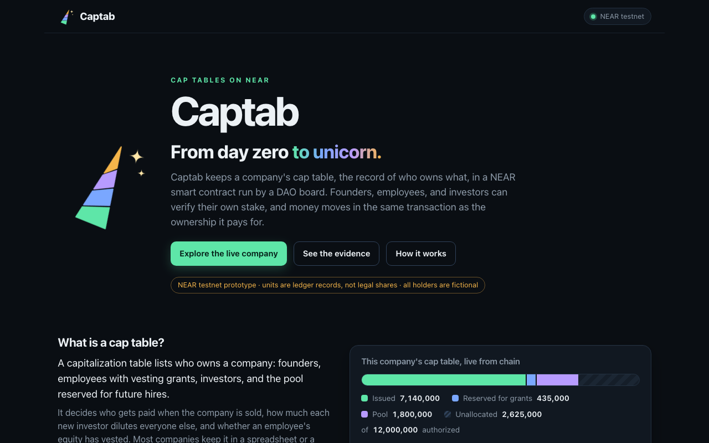
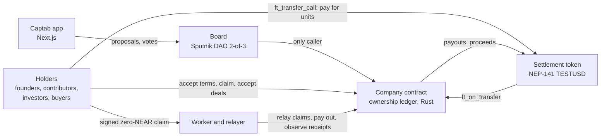

# Captab

**Your company's cap table on NEAR, from day zero to unicorn.**

Captab keeps a company's cap table, the record of who owns what, in a NEAR smart contract run by a DAO board. Founders split ownership, contributors vest and claim, investors pay and receive units in one transaction, early holders sell, holders get paid exactly once, and the books close at exit. Every step is live on NEAR testnet, and you can verify each one yourself.

[](https://github.com/mayohalo/captab/actions/workflows/ci.yml)

**[Live app: captab.xyz](https://captab.xyz)** · [Live company](https://captab.xyz/company/captab-company-0d07df99e1bb0e44.testnet) · [30-second video](docs/demo/captab-motion-30s.mp4) · [Evidence](docs/EVIDENCE.md) · [Summary for agents](https://captab.xyz/llms.txt)

[](https://captab.xyz)

> NEAR testnet prototype. Ownership units are on-chain ledger records, not legal shares. TESTUSD is a demo token, and all holders are fictional.

## The problem

A cap table decides who gets paid when a company is sold, how much each new investor dilutes everyone else, and whether an employee's equity has vested. Most companies keep it in a spreadsheet or a paid platform. Board approvals arrive by email, investor money is reconciled by hand, payouts are a separate manual process, and every holder has to trust whoever keeps the file.

## What Captab does

| | |
| --- | --- |
| **The board votes on-chain** | The board is a two-of-three council on a [Sputnik DAO](https://github.com/near-daos/sputnik-dao-contract). Every issuance, grant, round, deal, and payout is a proposal it votes on, and the company contract accepts ledger changes only from the DAO. |
| **The rules are code** | Supply never exceeds what is authorized, vesting follows its schedule, an action cannot be replayed, and no unit moves without the holder's signature. |
| **Money moves with ownership** | An investor's payment issues their units in the same transaction, or it is refunded. Payouts sum exactly to the budget and pay each holder once, even when a transfer fails and is retried. |

### From day zero to exit

| Stage | What the company gets | Contract calls | See it live |
| --- | --- | --- | --- |
| **1. Found** | Authorized units, the founder split with its agreement's SHA-256, founder vesting | `increase_authorized`, `issue_founder_units`, `create_grant` | [charter proposal](https://testnet.nearblocks.io/txns/JBCCbvP4YtmZFAmhcAxHaiPXC5Jy3W2iP9oW9pxzdVSn) |
| **2. Hire** | A pool and grants with any cliff and 1–120 monthly steps; contributors sign the terms and claim with **zero NEAR** | `create_grant`, `accept_grant`, `claim_vested` | [accept](https://testnet.nearblocks.io/txns/CE4y23r3fiRcM81FrCk9eDgpQadM6i8BWxKNHxyrMEba), [claim](https://testnet.nearblocks.io/txns/FyFBrAFfkQz1DLPTS9JQR5AsTVEf13Ecm5Q2FHZecmdf) |
| **3. Raise** | Priced rounds; each investor pays and receives units in one transaction, and the money lands in the DAO treasury | `create_round`, `approve_deal`, `ft_transfer_call` | [refund](https://testnet.nearblocks.io/txns/38fDEUrTUDA2jeHMUvqrnv4JSqJs4XsYnwyhjFTrsYNE), [payment](https://testnet.nearblocks.io/txns/DGY7VapS6G9b8XCzaT8y3LnMpXbb1mUpRUVydX184Jmd) |
| **4. Operate** | Board votes with replay protection, corrections, lost-wallet recovery, a CSV/JSON export carrying its SHA-256 | `retire_units`, `reassign_holding` | [export](https://captab.xyz/api/companies/captab-company-0d07df99e1bb0e44.testnet/export?format=csv) |
| **5. Liquidity** | Secondary sales and buybacks; a unit moves only with the board's approval and the holder's signature | `approve_deal`, `accept_deal`, `forward_proceeds` | [sale](https://testnet.nearblocks.io/txns/9gBWG3pbnz2yfSNwrZ6vZDN4QnDRjdgT2sv62aFYCGE9), [retry](https://testnet.nearblocks.io/txns/EGuQtscaKtLKcaEb1qiByeQGdG7ajRxJDNcJFpmB5KY6), [buyback](https://testnet.nearblocks.io/txns/EtXZJ5Egqj8mZqKZb3NoWmBvrdsci6gK6sT7v6apj9oj) |
| **6. Pay holders** | Distributions that sum to the budget exactly, funded once by the DAO, retry-safe per holder | `prepare_distribution`, `pay_recipient` | [v1 payout and retry](docs/testnet-rehearsal.json) |
| **7. Exit** | A preference waterfall paid as an explicit payout list, accelerated vesting, a closed ledger | `prepare_explicit_distribution`, `accelerate_grant`, `close_company` | [funding](https://testnet.nearblocks.io/txns/HVefYMr38JD72oebKw7gCR7BFb8vaTx61ThZ8Y9GQqCf), [payment](https://testnet.nearblocks.io/txns/9SZVkKe9RKhe8wMHF3j4v4c1djzucKBP1MREwCsg6cCb); close in [Sandbox](#3-run-the-whole-lifecycle-yourself-5-minutes) |

The app adds planning tools on top: a priced-round model (price per unit, new units, pool top-up, before and after), an exit waterfall with liquidation preferences whose rows become a payout-list proposal, and a cap table export.

## Try it

### 1. Click through the live app (1 minute, nothing to install)

1. **[captab.xyz](https://captab.xyz)**: what Captab is, with the live cap table and on-chain figures.
2. **[The live company](https://captab.xyz/company/captab-company-0d07df99e1bb0e44.testnet)**: the stage tracker, metrics, and ownership bar, read from NEAR testnet.
3. **[Deals](https://captab.xyz/company/captab-company-0d07df99e1bb0e44.testnet/deals)**: the seed round, the investor issuance, a secondary sale, and a buyback, all settled.
4. **[Distributions](https://captab.xyz/company/captab-company-0d07df99e1bb0e44.testnet/distributions)**: the explicit payout list paid to five holders, and the exit-waterfall planner.
5. **[Approvals](https://captab.xyz/company/captab-company-0d07df99e1bb0e44.testnet/approvals)**: every board action the app can propose, and the DAO's recent proposals.
6. **[Export the cap table](https://captab.xyz/api/companies/captab-company-0d07df99e1bb0e44.testnet/export?format=csv)**: the response headers carry the ledger revision and the file's SHA-256.

Board actions need a council wallet, so the live app is read-only for visitors. To watch every write happen, use option 3.

### 2. Verify the live chain yourself (1 minute, Node only)

```sh
git clone https://github.com/mayohalo/captab && cd captab
node apps/web/scripts/verify-evidence.mjs
```

This reads NEAR testnet directly. It checks that the deployed company, DAO, and token run the code hashes pinned in the [manifest](docs/deployment-manifest.v2.testnet.json), that the board is the pinned 2-of-3 council, that all 16 recorded DAO proposals executed, the 3 deals settled with proceeds delivered, the payout list was paid in full, and the totals, holdings, and DAO treasury match the recorded end state. It exits nonzero on any mismatch. [Sample output](docs/EVIDENCE.md#check-it-yourself).

### 3. Run the whole lifecycle yourself (5 minutes)

Requires Node 22.23+, pnpm 10.16.1, and Rust 1.88.0 with the `wasm32-unknown-unknown` target (pinned in `rust-toolchain.toml`).

```sh
pnpm install
pnpm demo:sandbox
```

This starts a local NEAR chain, deploys the pinned Sputnik DAO, the token, and the company, and runs the lifecycle through real two-of-three votes and token transfers:

```text
[1/6] Found: the board (2-of-3 Sputnik DAO) amends the charter and issues founder units with a document hash
[2/6] Raise: the board opens a seed round; a wrong payment is refunded, the exact one issues units and pays the DAO
[3/6] Secondary sale: the board approves, the seller locks units, the buyer pays, held proceeds are retried
[4/6] Buyback: the holder accepts, the DAO pays through a proposal, the units are retired
[5/6] Exit payout: the board sets an explicit payout list, funds it exactly, and every holder is paid once
[6/6] Close: with everything settled, the board closes the ledger; later calls are refused
Lifecycle complete: every step above ran on a local NEAR chain through real DAO votes and token transfers
```

### 4. Run all the tests

```sh
pnpm test:contract          # 74 Rust unit tests: supply invariants, vesting, replay safety, deals, payouts, close
pnpm test:sandbox           # 9 NEAR Sandbox tests: zero-NEAR sponsored claim, failed-then-retried payout, lost callback, storage at the limits, v2 lifecycle
pnpm --filter @captab/web exec playwright install chromium
pnpm test:e2e               # 26 browser tests: every screen against fixture chain views, including a schema v2 company
pnpm --filter @captab/web dev   # the app locally, against testnet (copy apps/web/.env.example to apps/web/.env.local first)
```

To deploy your own company, DAO, and token on testnet, follow the [runbook](docs/RUNBOOK.md).

## Proof

| | |
| --- | --- |
| **Live on testnet** | Company [`captab-company-0d07df99e1bb0e44.testnet`](https://testnet.nearblocks.io/address/captab-company-0d07df99e1bb0e44.testnet), board [`captab-dao-0d07df99e1bb0e44.testnet`](https://testnet.nearblocks.io/address/captab-dao-0d07df99e1bb0e44.testnet), token [`captab-token-0d07df99e1bb0e44.testnet`](https://testnet.nearblocks.io/address/captab-token-0d07df99e1bb0e44.testnet). 7,140,000 units across 5 holders, 16 executed DAO proposals, 3 settled deals, 72,940 TESTUSD in the treasury. |
| **Recorded** | Every transaction hash and the final state: [`testnet-v2-rehearsal.json`](docs/testnet-v2-rehearsal.json); code hashes and DAO policy: [`deployment-manifest.v2.testnet.json`](docs/deployment-manifest.v2.testnet.json). |
| **Re-checkable** | `node apps/web/scripts/verify-evidence.mjs` checks deployed code hashes, the DAO policy, and the live state against the records, with no keys and nothing installed. |
| **Tested** | 74 Rust unit tests, 9 NEAR Sandbox tests, 26 browser tests, 13 web test suites, all in CI. |
| **Earlier MVP** | Schema v1 at [`captab-company-101e85b169dd3522.testnet`](https://testnet.nearblocks.io/address/captab-company-101e85b169dd3522.testnet) ran browser-signed DAO votes, a zero-NEAR sponsored claim, and a failed-then-retried payout. Its code is tag `v1-testnet`, which rebuilds the deployed WASM byte for byte. |

The [evidence page](docs/EVIDENCE.md) maps every guarantee to the code that enforces it, the tests that prove it, and the testnet transaction that shows it.

## Transparent where it matters, private where it should be

| Public and verifiable | Private | Fingerprinted only |
| --- | --- | --- |
| Units per account, grants and vesting, rounds and prices, deals, payouts, and every board vote, on NEAR | The names and emails behind account IDs stay off-chain. Council members see them after a wallet-signed sign-in (NEP-413); every other holder sees only their own. | The charter and grant and purchase agreements stay with the company. Only their SHA-256 goes on chain, so anyone holding a copy can prove it is the approved version. |

Honest limit: amounts are public today; only identities are private. Confidential balances are on the roadmap.

## Ownership ledger today, share tokens next

Real equity cannot trade freely: transfers need the company's consent and the holder's. So Captab starts with an on-chain ledger that enforces those rules, then adds tokens on top.

1. **Built: on-chain ownership ledger.** Issuance, vesting, priced rounds, secondary sales, buybacks, and payouts, each approved by the board and signed by the holder.
2. **Next: restricted share tokens.** One NEP-141 token per share class, visible in wallets, with a transfer guard that enforces the same approvals. The ledger migrates once, from a hashed export ([design](docs/TOKENIZATION_PLAN.md)).
3. **Later: legal shares.** Legal wrappers that make on-chain units the company's source of truth, with confidential amounts.

## How it is built



| NEAR primitive | How Captab uses it |
| --- | --- |
| [Sputnik DAO](https://github.com/near-daos/sputnik-dao-contract) (pinned commit `5434a59`, WASM hash verified) | The board. The company contract trusts only the DAO as the immediate caller for ledger changes. |
| [NEP-141](https://github.com/near/NEPs/blob/master/neps/nep-0141.md) `ft_transfer_call` | Investors and buyers pay for deals, and the DAO funds payouts, in single transfers. Units move in the same receipt, or the token refunds the payment. |
| Promises and callbacks | Each payout is its own transfer with a private callback. A failed transfer can be retried; a lost callback stays locked rather than risking a double payment. |
| [NEP-366](https://github.com/near/NEPs/blob/master/neps/nep-0366.md) meta-transactions | A contributor with zero NEAR signs a `claim_vested` delegate action; a scoped relayer pays the gas. |
| [NEP-413](https://github.com/near/NEPs/blob/master/neps/nep-0413.md) signed messages | Wallet sign-in for private profiles. |
| NEP-297 events | Every ledger change emits a versioned `captable` event. |

| Path | Contents |
| --- | --- |
| [`contracts/company`](contracts/company/src) | The company contract (near-sdk 5.17): [`ledger`](contracts/company/src/ledger.rs), [`grants`](contracts/company/src/grants.rs), [`distributions`](contracts/company/src/distributions.rs), [`deals`](contracts/company/src/deals.rs), with unit and Sandbox tests |
| [`contracts/test-token`](contracts/test-token) | The NEP-141 TESTUSD fixture |
| [`apps/web`](apps/web) | The Next.js app, API routes (proposals, export, sponsor, auth, payouts), the worker, and deploy and verify scripts |
| [`docs`](docs) | [Evidence](docs/EVIDENCE.md), [runbook](docs/RUNBOOK.md), [operations](docs/OPERATIONS.md), [release status](docs/RELEASE_STATUS.md), [storage limits](docs/STORAGE_LIMITS.md), [tokenization plan](docs/TOKENIZATION_PLAN.md), [demo media](docs/demo/README.md) |

## Who it helps

- **Founders anywhere.** An auditable cap table with built-in payouts from one deployable contract, without paying for equity software or waiting on local legal infrastructure.
- **Contributors and employees.** Vesting they can verify themselves, claims that cost them nothing, and a path to cash through board-approved secondary sales.
- **Investors.** A valuation trail for every round and settlement in the same transaction, so there is nothing to reconcile.
- **DAOs, open-source projects, and co-ops.** Equity-like units for contributors, governed by the community's own council and enforced by code.

## What comes next

| | |
| --- | --- |
| **Next** | Sign the deal flows with third-party wallet extensions · restricted share tokens per class, migrated from the ledger · one-click company deployment through a factory contract · a history indexer |
| **Future** | Confidential amounts · stock options with an exercise price, SAFEs, and convertible notes · AI agents as operators or council members, held to the same DAO rules as people · legal wrappers |

## Honest limits

- **Testnet prototype.** Units are on-chain records, not legal shares, and TESTUSD is a demo token. An IPO itself happens off-chain: Captab hands the transfer agent or acquirer a verifiable export, pays the proceeds, and closes the ledger.
- **Close is proven in Sandbox.** `close_company` runs in `pnpm demo:sandbox`; the live company stays open as a demo.
- **Wallets.** Signing so far used local test keys and a Playwright wallet bridge ([browser evidence](docs/testnet-browser-rehearsal.json)); third-party wallet extensions are not yet verified.
- **History.** The activity page covers transactions submitted through the app; contract views are always the source of truth.
- **Lost callbacks.** If a token transfer succeeds but its callback fails, the payment stays locked for review, by design; there is no timeout reset.
- **Upgrades.** The contract has no self-upgrade method, and the deployer key is deliberately kept. Key removal is implemented (`pnpm freeze:company`) and proven in Sandbox. A production deployment would give upgrade authority to the DAO.

More: [release status](docs/RELEASE_STATUS.md) · [operations](docs/OPERATIONS.md) · [implementation plan](IMPLEMENTATION_PLAN.md)
