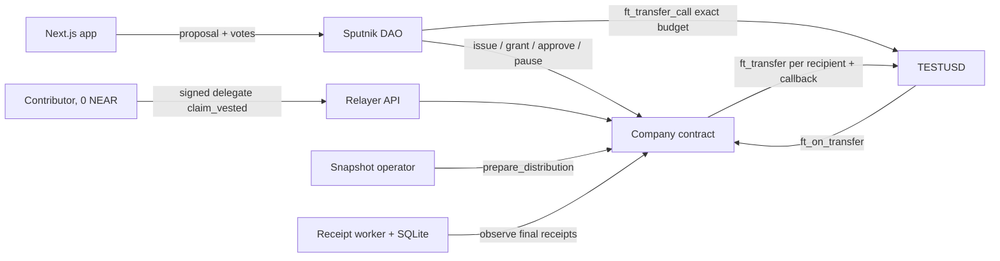

# Captab

**DAO-governed company ownership on NEAR.** A board approves issuance, contributor grants, and payouts through a Sputnik DAO. A company contract keeps the ownership ledger, vests grants monthly, and pays holders from an exact, immutable distribution snapshot, so no recipient is ever paid twice.

> Testnet prototype. Ownership units are on-chain ledger records, not share tokens or legal equity. TESTUSD is a demo NEP-141 token. All holders are fictional.

## Why NEAR

| NEAR primitive | How Captab uses it |
| --- | --- |
| [Sputnik DAO](https://github.com/near-daos/sputnik-dao-contract) (pinned commit `5434a59`, WASM hash verified) | A board approves every issuance, grant, cancellation, distribution approval, funding transfer, and pause. The company contract trusts only the DAO as the immediate caller. |
| [NEP-366 meta-transactions](https://github.com/near/NEPs/blob/master/neps/nep-0366.md) | A contributor with **zero NEAR** signs a `claim_vested` delegate action, and a scoped relayer pays the gas. |
| [NEP-141](https://github.com/near/NEPs/blob/master/neps/nep-0141.md) `ft_transfer_call` | The DAO funds a distribution in a single transfer. The contract accepts only the exact approved budget, from the DAO, once. |
| Promises and callbacks | Each payout is a separate `ft_transfer` with a private callback. A failed transfer can be retried; a lost callback stays locked rather than risking a double payment. |
| [NEP-413](https://github.com/near/NEPs/blob/master/neps/nep-0413.md) signed messages | Wallet-signed sign-in gives private (off-chain) access to names and emails. |
| NEP-297 events | Every ledger change emits a versioned `captable` event. |

## Live on testnet

| Role | Account |
| --- | --- |
| Company contract | [`captab-company-101e85b169dd3522.testnet`](https://testnet.nearblocks.io/address/captab-company-101e85b169dd3522.testnet) |
| Sputnik DAO (2 of 3 council) | [`captab-dao-101e85b169dd3522.testnet`](https://testnet.nearblocks.io/address/captab-dao-101e85b169dd3522.testnet) |
| TESTUSD (6 decimals) | [`captab-token-101e85b169dd3522.testnet`](https://testnet.nearblocks.io/address/captab-token-101e85b169dd3522.testnet) |

Code hashes, the full DAO policy, token supply, and storage funding are recorded in the [deployment manifest](docs/deployment-manifest.testnet.json). `pnpm verify:testnet` re-checks all of them against live chain state and exits nonzero on any drift.

Demo: [live read-only walkthrough](docs/demo/live-testnet.webm) (31 s) · [fixture walkthrough and screenshots](docs/demo/README.md)

## How it works



1. **Issue.** The board votes; the DAO calls `issue_founder_units` or `increase_pool`. Each call carries an `action_id` (replay-safe) and an `expected_revision` (rejected if stale).
2. **Grant and vest.** `create_grant` reserves pool units against 49 approved UTC month boundaries: a 12-month cliff, then monthly vesting to 48 months. The recipient calls `claim_vested` directly or through the sponsored relayer. Cancellation releases only unvested units.
3. **Distribute.** The operator prepares a snapshot. The contract derives every holder's payout with largest-remainder rounding, so payouts sum exactly to the budget, and hashes the schedule. The DAO approves that hash, then funds it. Payments run one recipient at a time; a failed one can be retried.

### Planning tools (app only)

These help a company plan its next steps. None of them proposes, signs, or changes anything on-chain.

- **Cap table export.** `GET /api/companies/<id>/export?format=csv|json` returns holdings, grants, pool, and totals at one ledger revision. The response headers give the revision and the SHA-256 of the file, so a lawyer or auditor can check they received the same file. It rejects a read during which the ledger changed. Spreadsheet formula characters are neutralized. Download links are on the ownership pages.
- **Priced-round model** (`/company/<id>/ownership`). Enter a pre-money valuation, an investment, and a pool target to see the price per unit, the new investor units, any pre-money pool top-up, and the before and after table. It warns when the round would need more units than are unallocated. Executing a round needs contract support for investor issuance, which is on the roadmap.
- **Exit waterfall preview** (`/company/<id>/distributions`). Splits sale proceeds across issued units and grants (accelerated or cancelled unvested units), after optional liquidation preferences (multiple, participating or not). Non-participating holders convert to common when that pays more. Integer math with largest-remainder rounding, the same rule the contract uses for payouts, so the rows sum to the proceeds exactly. Paying this schedule on-chain needs a distribution with an explicit payout list, which is on the roadmap.
- **Any majority council.** Governance works with any council size on the pinned Sputnik build, as long as only the council can vote and approval needs a majority. The app shows the rule (for example "2 of 3"). Code: [`dao-policy.ts`](apps/web/lib/dao-policy.ts), [`cap-table-export.ts`](apps/web/lib/cap-table-export.ts), [`round-model.ts`](apps/web/lib/round-model.ts), [`waterfall.ts`](apps/web/lib/waterfall.ts). Tests: `pnpm test:dao`, `pnpm test:planning`, and three browser tests.

## Claims and evidence

Every claim below is backed by a test you can run or a transaction you can open.

| Claim | Code | Local proof | Testnet proof |
| --- | --- | --- | --- |
| Only the DAO can change ownership | [`assert_dao`](contracts/company/src/lib.rs#L968) | `non_dao_cannot_issue` | Proposals [6](https://testnet.nearblocks.io/txns/6ekVUH6L7vbsWH4aeSjdG99RCbgKjB8W3hbPLQfdCU7v) and [7](https://testnet.nearblocks.io/txns/CpkKMtFCpVVYGrHAnc1bbApbrPJdUYvQnKtJw1SaMYJU) (pause/resume), each executed after [two](https://testnet.nearblocks.io/txns/9F1KBfKMoMLu7uj86uyG4T7ZD98fcPVbrdHsuQ3GBXJV) [votes](https://testnet.nearblocks.io/txns/GL8m4DFKDoFvBMqVyNUVXkbJXsquUMUSWq5FLCa4giXK) |
| A council majority is required (2 of 3 on testnet) | [`assessDaoPolicy`](apps/web/lib/dao-policy.ts) | Sandbox `real_sputnik_requires_two_votes_and_funds_company`; `pnpm test:dao` | Same as above |
| Replayed or repurposed actions cannot double-issue | [`was_processed`](contracts/company/src/lib.rs#L1006) | `identical_replay_is_idempotent_even_after_revision_changes`, `action_id_cannot_be_repurposed`, `stale_revision_rejected` | — |
| Supply invariants hold across every operation | [`unallocated`](contracts/company/src/lib.rs#L983) | `mixed_ledger_operations_preserve_accounting_after_every_step`, `cannot_exceed_authorized_supply` | `pnpm verify:testnet` audits the live ledger |
| Vesting: cliff, monthly steps, cancellation | [`vested_at`](contracts/company/src/lib.rs#L936) | `grant_reservation_cliff_claim_and_full_vesting`, `cancellation_releases_only_unvested_units`, `another_account_cannot_claim` | — |
| Contributor with zero NEAR claims via sponsored relay | [`claim_vested`](contracts/company/src/lib.rs#L763), [`apps/web/lib/sponsor-policy.ts`](apps/web/lib/sponsor-policy.ts) | Sandbox `zero_balance_contributor_claims_through_signed_delegate`; `pnpm test:sponsor` | Grant [proposal 8](https://testnet.nearblocks.io/txns/AHUbthZ5ZtauqMet2GTaQynoYp6xJUwdi2t712ub8GCZ) → [sponsored claim](https://testnet.nearblocks.io/txns/AAeXAhfrj6k76LiCSMDSwCA8f2kpMzAoRhqAZYiKz7Hh) |
| Payouts sum exactly to the budget, and later issuance cannot change them | [`prepare_distribution`](contracts/company/src/lib.rs#L282) | `snapshot_rounds_exactly_and_survives_later_issuance`, `distribution_hash_matches_typescript_vector` | 10,000.000000 TESTUSD paid as 5,975.103734 + 3,983.402490 + 41.493776 ([evidence](docs/testnet-rehearsal.json)) |
| Funding is accepted only for the exact approved budget, from the DAO, once | [`ft_on_transfer`](contracts/company/src/lib.rs#L473) | `only_exact_dao_token_funding_is_accepted_once`, `approval_rejects_modified_hash` | Distribution 0 funded, zero escrow left |
| A failed payment can be retried and never pays twice | [`pay_recipient`](contracts/company/src/lib.rs#L504), [`on_payment_result`](contracts/company/src/lib.rs#L559) | `failed_payment_releases_reservation_and_retry_pays_once`, `in_flight_attempt_blocks_duplicate_transfer`, `stale_payment_callback_cannot_settle_current_attempt`; Sandbox `seeded_demo_lifecycle_settles_exact_amounts_after_retry` | Contributor [attempt 1 failed](https://testnet.nearblocks.io/txns/3LaFRfpVNhoz2mMwFQ24ysNd8eeS8L7BBg7otP2s6ewf) (unregistered) → [attempt 2 paid](https://testnet.nearblocks.io/txns/59XfZEHbBXtFVNWPHQcQSFyQ7DSC4Lm4fgaJuHwPAiQy); founders [A](https://testnet.nearblocks.io/txns/DFj77QurbryvmF47k9EVAS1KWzMyi1JAQq4CH3nWsvYv), [B](https://testnet.nearblocks.io/txns/35NBSJHu9ZapVAkh3MfvEFoCR3Rn3oZzZk5X3i4Cqegj) |
| A lost callback stays locked instead of risking a double payment | [`on_payment_result`](contracts/company/src/lib.rs#L559) | `failed_callback_after_successful_transfer_never_unlocks_payment`; Sandbox `successful_token_transfer_with_failed_callback_stays_locked` (fault-injection build) | — |
| Pause stops new actions; in-flight callbacks still settle | [`set_paused`](contracts/company/src/lib.rs#L240) | `pause_rejects_new_funding_but_preserves_in_flight_callback_settlement`, `pause_blocks_new_payment_attempts` | Proposals 6 and 7 |
| Storage stays bounded at demo limits | [constants](contracts/company/src/lib.rs#L9) | Sandbox `bounded_storage_still_allows_payment_callback_at_demo_limits` ([measurements](docs/STORAGE_LIMITS.md)) | Storage preflight in the manifest |
| Worker crash or restart cannot cause a duplicate payout | [`apps/web/lib/payments.ts`](apps/web/lib/payments.ts) | `pnpm test:payments`, `pnpm test:worker-restart` | — |

Testnet transaction hashes come from the [payout rehearsal](docs/testnet-rehearsal.json) and the [browser rehearsal](docs/testnet-browser-rehearsal.json). Unit test names are in [`contracts/company/src/tests.rs`](contracts/company/src/tests.rs); Sandbox tests are in [`contracts/company/tests/sandbox.rs`](contracts/company/tests/sandbox.rs).

## Run it

Requires Node 22.23+, pnpm 10.16.1, and Rust 1.88.0 with the `wasm32-unknown-unknown` target (pinned in `rust-toolchain.toml`).

```sh
pnpm install
pnpm test:contract          # 28 Rust unit tests
pnpm test:sandbox           # 8 NEAR Sandbox tests: pinned Sputnik DAO, token, sponsored claim, payout retry
pnpm --filter @captab/web exec playwright install chromium
pnpm test:e2e               # 21 browser tests against fixture chain views
cp apps/web/.env.example apps/web/.env.local   # point at the testnet company
pnpm --filter @captab/web dev
```

CI ([`.github/workflows/ci.yml`](.github/workflows/ci.yml)) runs every web test, a production build, the worker restart test, the browser tests, the Rust tests, and the Sandbox lifecycle. To deploy your own instance, follow the [runbook](docs/RUNBOOK.md). For configuration and services (worker, relayer, private profiles), see [operations](docs/OPERATIONS.md).

## Wallets

The app connects through [`@hot-labs/near-connect`](apps/web/components/wallet.tsx). On testnet, browser-signed proposals, votes, and the sponsored claim were rehearsed with a local Playwright test-wallet bridge ([evidence](docs/testnet-browser-rehearsal.json)). Compatibility with third-party wallet extensions is not yet recorded. The sponsored-claim option appears only when the connected wallet supports delegate-action signing.

## Known limits

These limits are deliberate for a testnet prototype. The [release audit](docs/RELEASE_STATUS.md) has the full list.

- **Bounded demo state.** The contract allows at most 20 holders, 100 grants, 20 distributions, and 200 governance actions. Pause and resume also count toward the action limit, so a company paused at exactly 200 actions could not be resumed. A production version would exempt resume from the limit.
- **Lost callbacks need a recovery design.** If a token transfer succeeds but its callback fails, the payment stays locked for review. There is no timeout reset and no backend override, by design.
- **History covers app-submitted transactions only.** Current state is always read from contract views; complete external history would need an indexer.
- **Single-host worker.** The receipt and payment worker uses persistent SQLite, not ephemeral serverless storage.
- **Upgrades.** The contract has no self-upgrade method. The deployer key is still on the company account. Key removal is implemented (`pnpm freeze:company`) and proven in Sandbox (`deployment_key_can_be_removed_without_changing_company_code`), but it is deliberately not applied on testnet. Removing it would freeze the account's code permanently and close the migration path in the [tokenization plan](docs/TOKENIZATION_PLAN.md). A production deployment would give upgrade authority to the DAO.

## Roadmap

1. Investor issuance with round records, and a DAO-reviewed wallet replacement flow.
2. One restricted NEP-141 token per share class, whose balances become the sole on-chain ownership record after a reconciled migration ([design](docs/TOKENIZATION_PLAN.md)). Not implemented.

## Repository

| Path | Contents |
| --- | --- |
| [`contracts/company`](contracts/company/src/lib.rs) | Company contract (near-sdk 5.17.2), unit tests, Sandbox tests |
| [`contracts/test-token`](contracts/test-token) | Standard NEP-141 TESTUSD fixture |
| [`apps/web`](apps/web) | Next.js app, API routes (proposals, sponsor, auth, payouts), worker, deploy and verify scripts |
| [`docs`](docs) | [Implementation plan](IMPLEMENTATION_PLAN.md), [release audit](docs/RELEASE_STATUS.md), [runbook](docs/RUNBOOK.md), [operations](docs/OPERATIONS.md), [storage](docs/STORAGE_LIMITS.md), evidence JSON |
